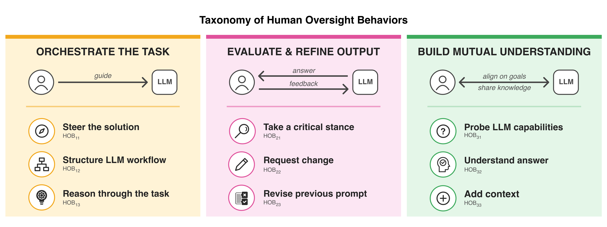

# WildChat-Dev-HOBs
## A Developer-LLM Interaction Dataset Annotated with Human Oversight Behaviors (HOBs)
This repository contains a developer-LLM interaction dataset curated from [WildChat-4.8M](https://huggingface.co/datasets/allenai/WildChat-4.8M) and annotated by human expert for presence of nine Human Oversight Behaviors (see below).

The dataset comprises 4,051 annotations (rows) across 3,288 unique turns from 467 unique conversations. The dataset contains 10 columns: six (`conversation_hash`, `conv_id`, `turn_id`, `context`, `user_prompt`, `last_assistant_reply`) describing the developer-LLM interaction and linking it to the original WildChat-4.8M dataset via the conversation hash, and four (`annot_start`, `annot_end`, `annot_text`, `hob_label`) containing the outputs of the annotation process, including the annotated text spans and their corresponding HOBs labels.

## ODC-By License
This HOBs-Dataset is made available under the Open Data Commons Attribution License: http://opendatacommons.org/licenses/by/1.0/
